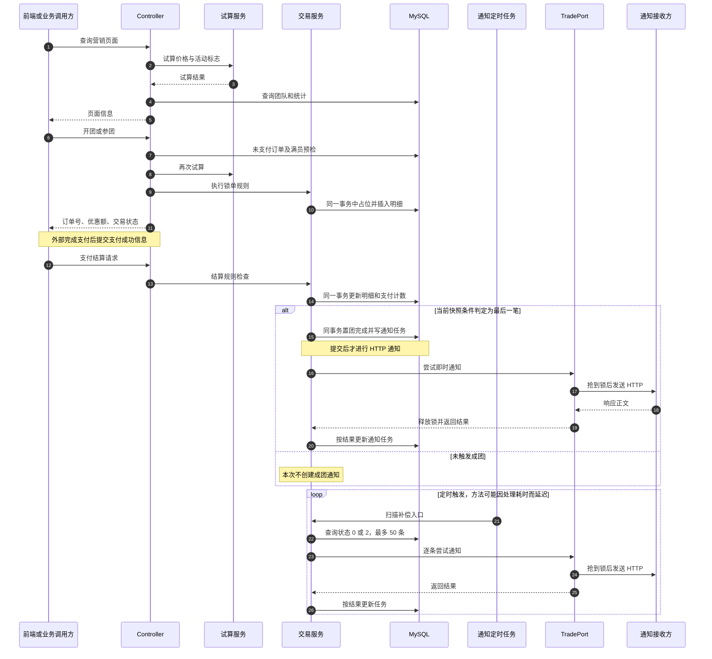
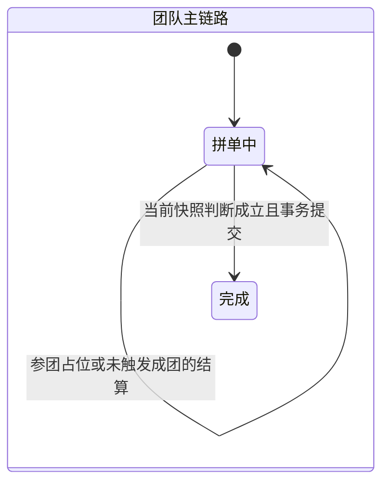
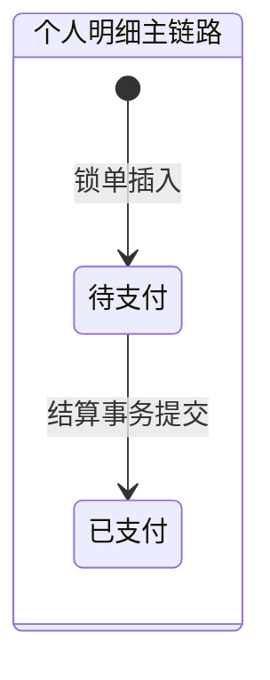
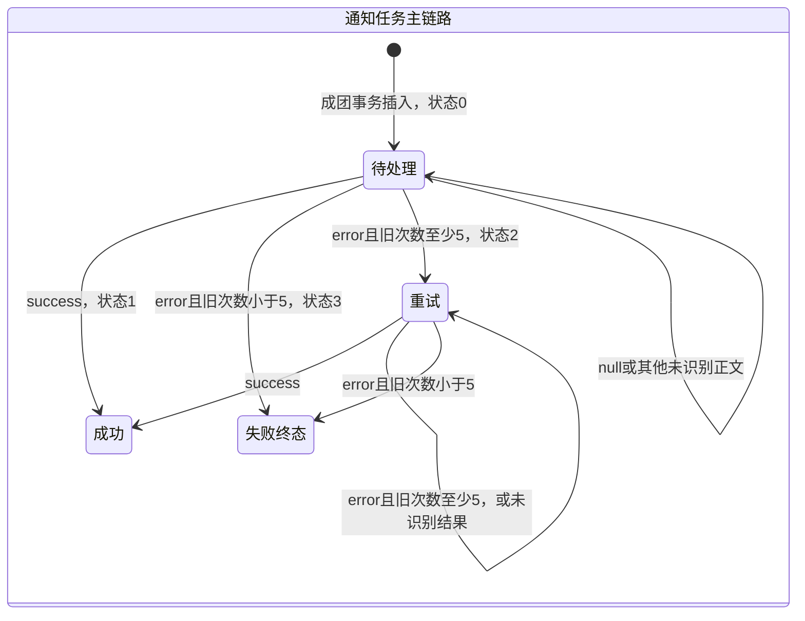

# group-buy-market 全流程与技术难点解析（修订版）

> 核对日期：2026-09-21。依据当前项目源码进行静态核对，未通过压测或故障注入验证生产可靠性。
> 本文将“源码已经实现的行为”和“尚未实施的改进建议”分开说明。代码片段标注为示意的，不代表可直接替换的完整实现。
> 旧版关于幂等、通知去重、N 策略、最低价、端口方向及部分修复 SQL 的错误，以本版为准。旧 drawio 图尚未同步修订。

## 阅读导航

1. 项目定位与基本概念
2. 一次拼团的完整流程
3. 难点：防超员、唯一索引与幂等
4. 难点：支付结算与成团一致性
5. 难点：通知任务、互斥与重试
6. 难点：DCC 动态配置
7. 难点：并行试算与折扣策略
8. 难点：责任链、上下文与分层
9. 难点：人群标签位图
10. 状态图、问题清单与面试表达
11. 源码阅读索引

## 1. 项目定位与基本概念

本项目处理拼团营销：给商品计算活动价格、为参团用户占位、接收支付成功信息、累计已支付人数，并在成团后通知业务方。它不是完整支付平台，也不能仅凭存在结算接口就认定已经接入真实支付渠道。

### 1.1 模块分工

| 模块 | 职责 |
|---|---|
| api | 对外接口契约、请求和响应 DTO |
| trigger | HTTP Controller、定时任务入口 |
| domain | activity、trade、tag 三个子域的业务逻辑和端口接口 |
| infrastructure | 仓储实现、DAO、Redis、HTTP 网关及 DCC 服务 |
| app | 启动、Spring 装配、线程池与连接配置、Mapper XML |
| types | 公共类型、异常、枚举、责任链和策略路由框架 |

技术基础包括 Java 8、Maven、Spring Boot 2.7.12、MyBatis Starter 2.1.4、MySQL、HikariCP、Redis、Redisson、OkHttp。MyBatis Starter 的版本不等于 MyBatis 核心库版本。

当前通知主链路没有使用 MQ；配置热更新也没有使用 Nacos。JWT 等依赖存在，不等于已经实现相应的业务功能。

`domain` 的项目内直接依赖是 `types`，另外有 Lombok、Fastjson 等库，不能写成“只依赖 api 和 types”。基础设施实现领域定义的接口，这是依赖倒置。

### 1.2 先区分三个业务对象

| 对象 | 表 | 通俗理解 |
|---|---|---|
| 团队 | group_buy_order | 一张需要凑齐人数的桌子 |
| 个人订单明细 | group_buy_order_list | 某位用户在这张桌子上的一笔参团记录 |
| 通知任务 | notify_task | 成团后需要送给业务方的一封通知 |

三个重要数字：

- `target_count`：成团需要的人数，例如 3。
- `lock_count`：已经占位的人数，包括尚未支付的订单。
- `complete_count`：已经结算到该团的支付数量，业务上希望对应实际支付人数。

例如目标 3 人，3 人都锁了单，但只有 1 人支付，则 lock_count=3、complete_count=1。此时“位置满了”，但没有成团。

这里的防超卖准确说是“防拼团人数超员”，不是商品库存扣减。

## 2. 一次拼团的完整流程

### 2.1 准备阶段：活动、人群和配置

活动、商品、折扣以及渠道商品与活动的映射保存在数据库中。人群批次任务通过 TagService 写入人群明细和 Redis 位图；当前用户列表是硬编码演示数据，不是自动计算出来的人群。

应用启动时，DCCValueBeanFactory 扫描带有 @DCCValue 的字段：Redis 配置不存在时写默认值；已存在时读取现值，然后注入 Bean。责任链与策略节点也在 Spring 启动装配过程中准备好。

### 2.2 营销页：先算价格，再组合页面信息

入口：`POST /api/v1/gbm/index/query_group_buy_market_config`。

MarketIndexController 先做营销试算，再查询个人进行中的团、其他团推荐及活动统计，组装页面响应。

试算正常路线：

```text
RootNode：校验用户、商品、来源和渠道参数
  → SwitchNode：检查降级开关、用户切量
  → MarketNode：并行查活动折扣配置和 SKU，然后计算价格
  → TagNode：计算活动对该用户是否可见、是否可参与
  → EndNode：组装试算结果
```

数据缺失会按节点路由进入 ErrorNode，其他异常也可能直接向上抛出，并非所有错误都统一经过 ErrorNode。

TagNode 的实际逻辑：

```text
tagId 为空：visible=true，enable=true
否则：visible = 配置允许可见 OR 命中人群
      enable  = 配置允许参与 OR 命中人群
```

因此不能理解成“只有在人群中才可见”。如果活动没有限制，即使不在人群中也可能可见、可参与。

### 2.3 锁单：用户点击开团或参团

入口：`POST /api/v1/gbm/trade/lock-market-pay-order`。

控制器依次进行：

1. 参数校验。
2. 按 userId、outTradeNo 查询未支付记录，找到则返回已有订单信息。
3. 传入 teamId 时做满员预检，已满返回 E0006。
4. 再次调用试算，获取活动与价格信息。
5. 调用 TradeLockOrderService 执行锁单规则链与事务落库。

“再试算一次”的意义是下单时重新计算，而不是直接相信页面之前显示的优惠金额。但仍应校验传入活动、试算命中活动、目标团队之间的业务一致性。

当前控制器取得试算结果后直接构建锁单对象，没有根据 `trialBalanceEntity.enable` 显式拒绝参与。不要把“试算计算了参与标志”描述为“交易入口已经强制执行人群限制”。

锁单规则链只有两个节点：

```text
ActivityUsabilityRuleFilter
  校验活动是否生效、当前时间是否在活动区间
  → UserTakeLimitRuleFilter
  查询用户参与次数，与活动限次比较，返回已参与次数
```

次数是责任链的返回结果，不是写进 DynamicContext 返回。ActivityUsabilityRuleFilter 没有文档旧版所说的 E0007 人数检查。

随后进入 TradeRepository.lockMarketPayOrder 的事务：

```text
未传有效 teamId → 开团 INSERT，初始化 lock_count=1、complete_count=0
传了 teamId    → 条件 UPDATE，把 lock_count 加 1
两条分支合并   → 插入个人订单明细，构造 biz_id
成功提交       → 返回锁单结果
失败抛异常     → 按事务规则回滚
```

当前 LockMarketPayOrderResponseDTO 返回的是 orderId、deductionPrice 和 tradeOrderStatus，不能画成直接返回 payPrice。应付价参与了内部计算和业务对象构造，但具体接口返回字段要以 DTO 为准。

### 2.4 支付：本项目接收结果，不代表已经实现支付平台

外部业务完成支付后，通过以下接口提交支付成功信息：

`POST /api/v1/gbm/trade/settlement_market_pay_order`

主要信息包括 userId、outTradeNo、outTradeTime、source、channel。真实支付的签名校验、支付金额核验、退款等能力不能从这个接口本身推断已经完成。

### 2.5 结算：记一笔支付，再判断是否成团

MarketTradeController 调用 TradeSettlementOrderService，其规则链顺序为：

| 节点 | 当前行为 |
|---|---|
| SCRuleFilter | 检查渠道黑名单 |
| OutTradeNoRuleFilter | 查 userId、outTradeNo 对应的未支付明细，查不到则 E0104 |
| SettableRuleFilter | 查询团队快照；要求 outTradeTime 严格早于 validEndTime |
| EndRuleFilter | 将上下文中的团信息组装为规则链返回结果 |

当前时间检查只验证结束时间，不能写成已经同时验证有效期的上下界。

仓储事务内依次：

1. 将个人明细置为已支付，记录 outTradeTime。
2. 条件递增 complete_count，不允许超过 target_count。
3. 用规则链之前读到的快照判断 `targetCount - 1 == completeCount`。
4. 判断成立时，把团从状态 0 改成 1，查询已支付单号列表，并写 notify_task。
5. 事务返回 true 时，领域服务立即尝试通知；否则等待后续订单结算。

第 3 步存在并发问题，见第 4 章。业务期望是凑齐人数后成团，当前代码并不能保证所有并发场景都实现这个期望。

### 2.6 通知：即时尝试与定时补偿

通知有两个入口：

- 成团后，对该 teamId 立即查询并尝试发送任务。
- GroupBuyNotifyJob 每 15 秒调用扫描入口，查询状态为 0 或 2 的任务，每批最多 50 条。

任务交给 TradePort：取得团队级 RLock，抢锁成功后通过 GroupBuyNotifyService 发 HTTP POST，最后释放锁。返回结果交给领域服务，再更新任务状态。

模拟接收接口是 `POST /api/v1/test/group_buy_notify`，当前恒返回 success。它适合验证成功链路，不代表重试、并发和故障恢复都通过了测试。

### 2.7 主链路时序图



## 3. 难点：防超员、唯一索引与幂等

### 3.1 条件 UPDATE 为什么能防超员

参团 SQL 的关键部分：

```sql
UPDATE group_buy_order
SET lock_count = lock_count + 1, update_time = NOW()
WHERE team_id = ? AND lock_count < target_count;
```

假设只剩一个位置，A、B 同时参团。同一团记录的更新由数据库锁协调：A 成功占到最后一位并提交后，B 的更新不再满足条件，影响行数为 0。若 A 回滚，位置仍可供后续请求争取。

亮点是“检查是否有位置”和“占位”在一条数据库语句中完成。控制器的满员查询只是提前给出提示，真正的并发防线在 UPDATE。

这里不是“完全不加锁”，而是使用 MySQL 的锁与事务，不额外引入 Redis 锁来包住占位操作。热门团队仍可能出现行锁等待。

同一团记录的并发更新靠 InnoDB 行锁保证单条 UPDATE 的原子性；判定语义是条件更新（CAS）——检查与占位在同一条语句完成，竞争失败方影响行数为 0，不排队继续、也无需版本重试。

项目里真正的悲观锁实例在通知链路：TradePort 的 Redisson RLock（tryLock(3, 0, SECONDS)）。面试时对比着讲很加分：占位用 CAS 条件更新，通知用互斥锁，同一项目两种策略各有场景。

低冲突、单点资源、判断可入 SQL 时，CAS 确实是最省的（互斥免费搭车在业务写上）；但"比悲观锁/分布式锁强"只在它的适用边界内成立——通知链路的临界区是一次 HTTP 外部调用，一条 SQL 表达不了，那里只能而且应该用分布式锁。

所以说更新数据时，更适合乐观锁。

### 3.2 防超员为什么不等于幂等

如果一个团还剩两个位置，同一 UPDATE 执行两次，可能成功两次。它保证“不超过上限”，不保证“同一请求只产生一次效果”。

项目构造：`biz_id = activityId_userId_(已参与次数+1)`，通过唯一索引阻止相同业务键重复插入。

例如同一用户两个并发请求都查到已参与 0 次，就都尝试插入 `_1`，其中一个会唯一键冲突。占位和插入明细位于同一事务，失败事务的占位也应回滚。

但第一个请求完成后，下一个请求可能读到次数 1，生成 `_2`。这说明该键表示“第几次参与”，并不是永久不变的请求编号。

### 3.3 应分别描述的三道防线

| 防线 | 解决什么 | 不保证什么 |
|---|---|---|
| 未支付订单查询 | 找到既有订单时返回已有结果 | 查询后写入之间无并发竞争 |
| 条件 UPDATE | 单团占位计数不越界 | 每个请求只执行一次 |
| biz_id 唯一索引 | 相同参与序号不重复插入 | 用户只能参与一次、所有重试都返回相同结果 |

建议：按业务约定选择稳定的幂等键，例如渠道与外部交易号的组合，并明确数据库唯一约束、重复请求返回规则。不能在唯一键冲突后无条件换一个参与序号重试，否则可能把同一请求变成第二笔订单。

## 4. 难点：支付结算与成团一致性

### 4.1 同事务写通知任务的价值

团队完成与 notify_task 插入在同一事务中：正常通过该分支提交时，两项写入一起生效，失败则一起回滚。这样避免“完成状态单独提交后进程退出，还没来得及记录通知任务”的窗口。

但它只约束数据库内的写入，不保证 HTTP 接收方必定处理成功，也不修复进入成团分支之前的漏判。

### 4.2 快照漏判的例子

目标 3 人，数据库已有 1 人完成支付。A、B 是剩余两名用户。

| 时刻 | A | B | 数据库 complete_count |
|---|---|---|---|
| 1 | 规则链读到 1 | 规则链也读到 1 | 1 |
| 2 | 事务递增为 2 | 等待同一团记录更新 | 2 |
| 3 | 用旧值判断 3-1==1，不成立，提交 | 随后递增为 3 | 3 |
| 4 | 已结束 | 仍用旧值判断 3-1==1，不成立，提交 | 3 |

结果是计数达到目标，但状态没有转为完成，也没有通知任务。这是静态代码可以构造出的竞态，不是本文已经实测出的压测结果。

### 4.3 修复方向：以事务内实际结果决定是否成团

以下为建议顺序，并未修改业务代码：

1. 条件更新个人订单 `status=0 → 1`；只有首次转换成功才继续计数。
2. 递增 complete_count，并检查影响行数。
3. 在同一事务内执行下面的完成状态转换。
4. 仅成功转换状态的事务查询已支付明细并插入通知任务。

```sql
-- 建议 SQL：位于 complete_count 已经递增之后
UPDATE group_buy_order
SET status = 1, update_time = NOW()
WHERE team_id = ?
  AND status = 0
  AND complete_count = target_count;
```

此处影响 0 行通常表示本次未触发完成，不能照搬原来“任何 0 行都抛错”的处理。仍需区分正常未满、非法团状态等业务情形，并在集成测试中验证事务与通知名单。

不能在递增后用 `complete_count=target_count-1` 判定完成，那会提前一个人完成。

### 4.4 支付重复回调的并发窗口

当前明细 UPDATE 只按 userId、outTradeNo 定位，没有 `AND status=0`。上游查询可拦住已提交后的重复回调，但两个并发请求可能同时通过查询。

建议补条件状态更新，并在影响行数为 0 时识别“已结算”与“订单不存在”等情形，返回清晰结果，而不是再次累加支付人数。

### 4.5 事务超时的准确含义

`@Transactional(timeout=500)` 的单位是秒。它不是 500ms，也不应被描述为精确计时后强制中止任意 Java 代码。具体超时执行与事务管理器、数据库访问方式有关。

`timeout=1` 表示一秒，不是 500ms 的替代值。是否调整该配置，需要结合 SQL、连接池和业务响应预算判断。

## 5. 难点：通知任务、互斥与重试

### 5.1 当前代码的完整结果表

| 返回结果 | 当前处理 | 后续扫描 |
|---|---|---|
| success | 次数加一，状态置 1 | 不再扫描 |
| error 且旧次数小于 5 | 次数加一，状态置 3 | 不再扫描 |
| error 且旧次数大于等于 5 | 次数加一，状态置 2 | 继续扫描 |
| null | 次数、状态均不变 | 原本为 0 或 2 时仍可扫描 |
| 其他响应正文 | 当前无对应处理分支 | 状态不变 |

初始次数为 0，所以第一次返回 error 就进入状态 3。不能写成“失败五次后停止”。新任务也不能仅靠正常 error 分支自行积累到五次。

GroupBuyNotifyService 直接读取 HTTP 响应正文，没有按 HTTP 状态码判断成功。因此不能认为 HTTP 500 必然抛异常，也不能认为 HTTP 200 必然被记录为成功；当前是否识别成功取决于正文是否恰好为 success。

### 5.2 互斥为什么不能等于不重复

当前锁覆盖发送动作，发送结束释放锁，然后服务才更新任务状态。即使互斥正常生效，也可能出现：

```text
A、B 提前读出同一条任务
A 拿锁 → 发送成功 → 释放锁
B 随后拿锁 → 用之前读出的任务再发送一次
```

更普遍的情况是接收方处理成功，但发送方没有收到响应。重试仍可能再次送达。

因此本项目具备本地任务表和补偿机制，但不能宣称“严格不重复”或“已经保证最终一致”。应由接收方按事件或业务键幂等处理。

### 5.3 更清晰的改进方案

建议补足以下行为，而不是只交换两个失败分支：

- 明确最大尝试次数是否包含首次发送。
- 对真实发送失败计次，超过上限进入终态并保留人工处理入口。
- 区分抢锁失败、网络异常、HTTP 非成功状态和业务明确拒绝。
- 增加下次重试时间，避免每轮都立即重打失败任务。
- 抢到处理权后重新确认任务状态，或使用数据库任务认领机制减少重复处理。
- 接收方建立幂等约束，处理“成功但响应丢失”的重复投递。
- 成功状态、失败状态的更新也需要避免被持有旧任务的实例覆盖。

`LIMIT 50` 只代表单批数量上限。当前没有明确的公平调度和重试时间，长期失败的任务可能反复占用扫描名额。实际调度还受单批处理耗时影响，不是每条任务都严格每 15 秒完成一次投递。

### 5.4 锁与异常处理的边界

当前调用是 `tryLock(3, 0, TimeUnit.SECONDS)`。三个参数不能解释为“整个通知在 3 秒内结束”；第一个参数是获取锁的等待预算。

旧版把 leaseTime=0 无条件解释成可靠的看门狗保证，表述过强。本次项目级核对不将该说法作为已验证结论；具体语义应结合所用 Redisson 版本实现和测试确认。不能把它作为业务去重证明。

TradePort 对所有 Exception 都设置线程中断标记，这是不恰当的。建议只对 InterruptedException 恢复中断状态，其他异常按故障类型处理。

HTTP 异常和抢锁失败当前均可返回 null，且都不增加次数，不能根据 notify_count 区分两者。网关已有 HTTP 异常日志，应结合该日志排查，并改进结构化返回结果。

## 6. 难点：DCC 动态配置

### 6.1 把注解、Redis 和内存字段串起来

```text
启动：扫描 @DCCValue
  → Redis 不存在就写默认值；存在就读现值
  → 反射写入 Bean 字段
  → 保存配置键到目标 Bean 的映射

变更：DCCController 发布 key,value 消息
  → Redis 订阅回调接收
  → 写 bucket
  → 找到 Bean
  → 反射更新字段

请求：SwitchNode 或 SCRuleFilter 通过仓储接口读取配置语义
```

业务请求通常读取的是当前进程的配置字段，不是每次都重新订阅消息。“共享同一配置”指共同使用该配置机制，不代表所有实例共享同一块内存。

### 6.2 三个配置的作用

- downgradeSwitch：试算是否直接拦截。
- cutRange：按用户哈希桶决定是否允许试算。
- scBlacklist：结算时是否拦截来源与渠道组合。

当前切量公式为 `Math.abs(userId.hashCode()) % 100 <= cutRange`。普通非负桶号为 0 至 99，因此配置 0 仍放行桶 0，配置 10 覆盖 11 个桶。用户分布也不保证均匀，不能说精确放行 10% 用户。

建议校验比例范围，使用 `Math.floorMod(hash, 100) < percent`，同时避免 Math.abs(Integer.MIN_VALUE) 的负值边界。

### 6.3 能热更新，不等于可靠配置中心已经完整实现

Pub/Sub 断线期间可能漏掉更新；当前发布端先发布消息，由监听回调写 bucket，不是发布端先持久化再通知。没有成功处理消息的订阅者时，不能保证新配置已经保存。

此外，普通字段的跨线程可见性、非法配置值、多字段一致更新、配置版本、回滚和重连补偿都需要明确处理。反射写字段本身不等于完成这些保证。

建议将配置值和版本先可靠保存，再发布变更提示；实例收到提示后拉取现值，并通过启动加载、重连加载或定期核对补偿丢失。进程内使用适当的线程安全配置载体。

## 7. 难点：并行试算与折扣策略

### 7.1 并行的是取数，结果汇合后才算价

模板骨架是：

```java
// 源码执行结构
multiThread(request, context);
return doApply(request, context);
```

MarketNode 提交活动查询和 SKU 查询，然后等待两个 FutureTask，将结果写入本次请求的上下文，再计算价格。

假设活动查询 80ms、SKU 查询 50ms，在资源足够且无额外排队时，串行取数约 130ms，并行取数接近较慢的 80ms，另外还有调度和数据库开销。这是原理示例，不是本项目实测指标。

HTTP 请求线程仍会等待结果，不能理解为接口已经完全异步返回，也不能说把两个数据库请求真的合成了一次数据库往返。

### 7.2 当前超时不是 5 秒

AbstractGroupBuyMarketSupport 定义 timeout=5000，而 MarketNode 使用 `get(timeout, TimeUnit.SECONDS)`，所以单次等待参数是 5000 秒。

建议使用明确单位，例如 5 秒或 5000 毫秒；两个 get 的等待预算也不是天然共享的接口总预算。队列等待、CallerRunsPolicy 在提交线程执行任务等因素还可能影响总耗时。

FutureTask 支持 cancel，但当前超时分支没有调用。即使调用 cancel(true)，也不保证数据库查询立即终止，应配合查询超时、连接配置和线程池容量处理。

### 7.3 折扣策略的准确行为

| 策略 | 含义 |
|---|---|
| ZJ | 直减 |
| ZK | 折扣 |
| MJ | 满足门槛时减金额 |
| N | 将表达式解析为最终价格，即 N 元购 |

Spring 把策略按 Bean 名注入 Map，marketPlan 用于选择实现。新增能由现有输入表达的算法时，可以增加策略实现并配置对应标识；若新玩法需要购买件数等新信息，仍需扩展请求或领域模型，不能一概说“所有玩法都只加一个类”。

父类先检查 TAG 折扣人群，未命中则返回原价；命中或无需检查时调用 doCalculate。父类没有统一包装 ensureMinimumPrice。

最低价方法由部分策略调用，N 策略没有调用；该方法只处理 null 或非正数，也不是对所有小于 0.01 的正数做下限截断。金额精度、配置合法性与零元活动政策需要另行制定。

## 8. 难点：责任链、上下文与分层

### 8.1 责任链约定

BusinessLinkedList 遍历节点：返回 null 就继续；返回非 null 就作为最终结果；抛异常则中断。

锁单链最后返回用户参与次数，结算链最后返回团队信息。因此“规则全通过一定返回 null”不符合当前业务链。

DynamicContext 用于本次链执行中的中间数据。例如结算链先查明细，再根据团号查团队，最后组装输出。它不是全局跨请求共享对象。

LinkArmory 只负责把传入节点加入链表，没有保证至少传一个节点。BusinessLinkedList 对空链缺少保护，当前配置传了节点并不代表框架已经验证空链。

### 8.2 两套链与策略路由分别解决什么

model1 展示由节点衔接 next 的链式执行；model2 使用统一遍历；策略路由由节点选择下一处理节点。锁单、结算复用 model2，试算复用路由模板。

通用设计框架放 types，具体节点放 domain；不能据此说整个 types 模块完全没有业务词汇，它也包含业务异常和枚举。

### 8.3 端口方向看调用关系，不看数据流向

- 入站：外部调用系统用例，例如 Controller、Job 调用领域服务。
- 出站：领域用例调用外部能力，例如仓储存取数据、发送通知。

所以 ITradeRepository 和 ITradePort 都属于出站端口。Repository 返回数据，不会因此变成入站端口。

亮点是 TradeSettlementOrderService 面向接口，数据库与 HTTP 的实现集中在 infrastructure。更准确叫端口适配器隔离；简单转换 DTO 不一定就构成完整的防腐层。

改用 MQ 是否只改一个类取决于接口语义。现有端口返回 HTTP 风格的 success/error，若消息入队与下游处理完成的含义不同，领域服务和任务状态协议也可能需要调整。

## 9. 难点：人群标签位图

### 9.1 写与读分别做什么

写入：TagService 获得演示用户列表，TagRepository 写 MySQL 明细，再计算用户下标并设置 Redis bit。重复明细被忽略后仍会设置 bit。

读取：ActivityRepository.isTagCrowRange 检查位图；不存在就返回 true，否则读取用户对应的 bit。

查询成员资格用于 TagNode 和 TAG 折扣逻辑。计算活动参与标志，不等于锁单接口已经拒绝所有不符合人群的请求。

### 9.2 O(1) 指成员查询，不是整个圈选任务

GETBIT 按下标读取，查询成本不随已写入人数逐条增长。但收集全体目标用户、写数据库、逐个更新位图仍需要工作量。

当前源码映射为：`MD5(userId) mod Integer.MAX_VALUE`。下标可能很大，且两个不同用户可能落在同一 bit。

### 9.3 内存与误判是两笔账

位图有效载荷大小取决于最大写入下标，大致为 `floor(maxOffset/8)+1` 字节，而不是简单取“已加入用户数除以 8”。当前下标范围的上端对应约 256 MiB。

均匀散列假设下，少量用户也可能写到很高位置，但“4 个用户必然超过 200MB”不是事实；要给实际占用应读取真实位图长度或测量内存。

缩小取模空间能限制容量，却会提高碰撞与误判。建议根据是否允许误判选择精确 Set、唯一连续编号的位图或概率型方案，不能只改模数就宣称同时解决内存与准确性。

位图不存在时返回 true 是当前放行策略，不是普适的安全降级。Redis 数据丢失会放宽资格限制；Redis 请求异常也不等于键不存在，不会天然进入这条放行分支。

## 10. 状态图、问题清单与面试表达

### 10.1 分开看三个对象的状态

以下只展示当前主链路使用的状态，不表示其他枚举值一定不存在。







通知图描述代码分支，不意味着新任务能正常一路重试到五次。支付结算与团队完成是跨对象的业务关系，不应把个人“已支付”画成团队的一种状态。

### 10.2 建议优先处理的问题

| 优先事项 | 当前行为或风险 | 建议方向 |
|---|---|---|
| 成团漏判 | 使用事务外计数快照 | 基于递增后的数据库状态原子转为完成 |
| 并发重复结算 | 明细更新缺少状态条件 | 首次状态转换成功后才递增计数 |
| 通知失败处理 | 第一次 error 就进入不再扫描的状态 | 明确次数语义，补退避、终态和补偿入口 |
| 通知重复 | 锁不能阻止顺序重复与响应丢失重试 | 任务处理权协调、状态校验、接收方幂等 |
| 超时单位 | 试算 get 使用 5000 秒 | 修正单位并设置整体耗时预算 |
| 人群参与限制 | 计算 enable 后未见锁单显式检查 | 交易入口实施资格校验 |
| 占位回收 | 当前没有完整未支付关闭和释放链路 | 用截止时间判断，事务内关闭明细并回补名额 |
| 位图容量 | 哈希下标空间过大 | 按准确性与容量需求重选映射或数据结构 |
| DCC 一致性 | 消息丢失、可见性和非法值边界 | 持久值加版本、补偿拉取、线程安全配置载体 |

占位回收建议不能用 out_trade_time 判断未支付超时，应依据创建时间或支付截止时间；也必须与迟到支付结算协调，不能只补一条减人数 SQL。

### 10.3 面试表达：突出已实现的设计，不夸大结果

**问：如何防止团满了还有人加入？**

答：用带人数上限条件的 UPDATE，把判满和占位放在同一条 SQL 中，按影响行数判断是否占位成功。占位和明细写入同事务完成，失败回滚。它负责防超员，重复请求还需要独立的幂等约束。

**问：为什么成团后先写任务再通知？**

答：团队完成与通知任务在同一个数据库事务里提交，减少完成状态有了但没有发送记录的窗口。提交后尝试发送，定时任务补偿。当前实现还需要完善重试状态和下游幂等，不能保证只发送一次。

**问：项目最值得改进的并发问题是什么？**

答：成团使用之前查出的计数快照，最后两人同时支付可能都不触发完成。应让结算只计一次，再依据事务内递增后的真实计数完成状态转换，由完成转换成功的事务写任务。

**问：试算如何扩展与提速？**

答：活动和 SKU 两个独立查询并行执行，结果汇合后算价；算法按 Spring Bean 名注册为策略 Map。当前存在等待超时单位问题，需先修复并验证，不能提供未经测量的性能提升数字。

**问：人群位图的取舍是什么？**

答：按下标查询快，但当前哈希下标会带来碰撞和较大的位图分配。内存不能按人数简单估算；若资格必须准确，应选择精确集合或无冲突编号映射。

## 11. 源码阅读索引

以下路径相对项目根目录，可按类名或方法定位。减少固定行号，避免代码变动后引用失效。

| 内容 | 文件位置 |
|---|---|
| 页面与锁单入口 | group-buy-market-trigger/src/main/java/cn/bugstack/trigger/http/MarketIndexController.java、MarketTradeController.java |
| 通知任务入口 | group-buy-market-trigger/src/main/java/cn/bugstack/trigger/job/GroupBuyNotifyJob.java |
| 试算节点 | group-buy-market-domain/src/main/java/cn/bugstack/domain/activity/service/trial/node/ |
| 试算 timeout | group-buy-market-domain/src/main/java/cn/bugstack/domain/activity/service/trial/AbstractGroupBuyMarketSupport.java |
| 折扣模板及策略 | group-buy-market-domain/src/main/java/cn/bugstack/domain/activity/service/discount/ |
| 锁单规则链 | group-buy-market-domain/src/main/java/cn/bugstack/domain/trade/service/lock/ |
| 结算规则及通知状态分支 | group-buy-market-domain/src/main/java/cn/bugstack/domain/trade/service/settlement/ |
| 核心事务 | group-buy-market-infrastructure/src/main/java/cn/bugstack/infrastructure/adapter/repository/TradeRepository.java |
| 人群读写 | group-buy-market-infrastructure/src/main/java/cn/bugstack/infrastructure/adapter/repository/ActivityRepository.java、TagRepository.java |
| 位图下标 | group-buy-market-infrastructure/src/main/java/cn/bugstack/infrastructure/redis/IRedisService.java |
| 通知锁与 HTTP | group-buy-market-infrastructure/src/main/java/cn/bugstack/infrastructure/adapter/port/TradePort.java；infrastructure/gateway/GroupBuyNotifyService.java |
| DCC 装配 | group-buy-market-app/src/main/java/cn/bugstack/config/DCCValueBeanFactory.java |
| DCC 消费配置 | group-buy-market-infrastructure/src/main/java/cn/bugstack/infrastructure/dcc/DCCService.java |
| SQL | group-buy-market-app/src/main/resources/mybatis/mapper/group_buy_order_mapper.xml、group_buy_order_list_mapper.xml、nofify_task_mapper.xml |
| 通用设计框架 | group-buy-market-types/src/main/java/cn/bugstack/types/design/framework/ |

配套旧图位于 docs/analysis-drawio。本次修订仅更新本文，旧图及旧简历中的“严格去重”“5 秒超时”“千万用户 1.25MB”等说法不能视为当前源码保证。
