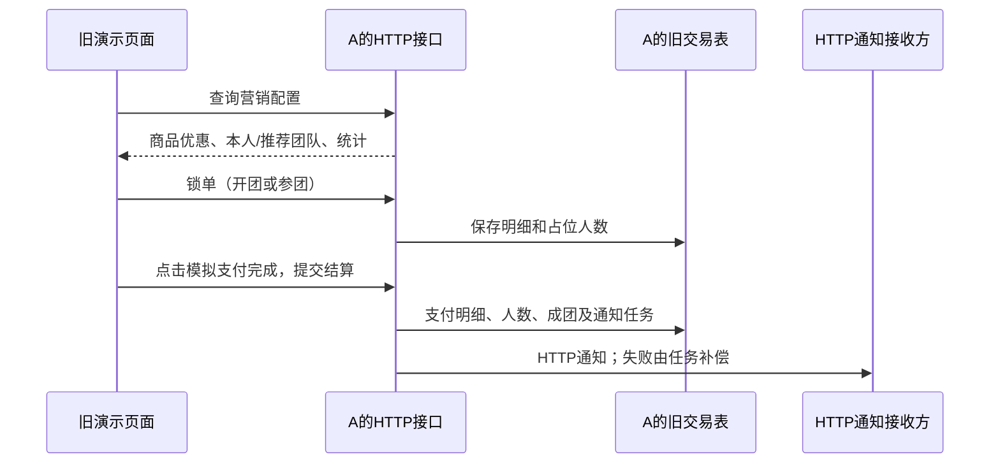
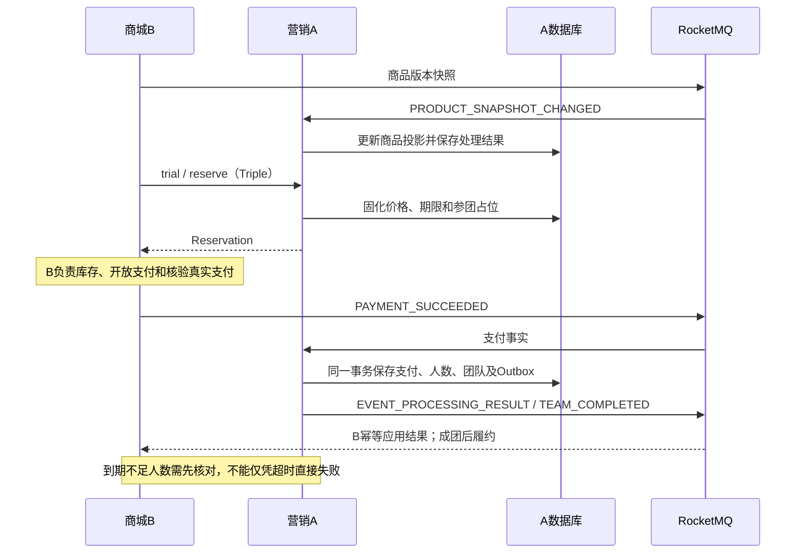

# 项目 A：V1 与 V2 改造对比

核对日期：2026-10-11。依据当前项目 A 源码、SQL、[A/B 契约](ab-api-contract.md)和[交付报告](phase5-ab-v2.md)。本文不把历史验收视为本日重新测试，也不代表实际项目 B 已接入完成。

## 1. 改造结论与版本含义

V2 将 A 从旧页面直接调用的拼团后端，扩展为向商城 B 提供营销能力的服务。B 负责用户、商品基础资料、库存、商城订单、真实支付、退款及履约；A 负责活动、优惠资格、参团占位、支付事实处理、团队状态和可靠事件。

实现方式是**保留 V1，新增 V2 链路，并复用部分领域能力**。它不是把原 Controller 换成 Dubbo 注解，也不是将全部旧订单迁移到新表。

本文中的 V1 指当前仓库仍保留、已包含前四阶段 Bug 修复的旧 HTTP 链路，并非最初未经修复的代码；V2 指此次面向 B 的 Triple RPC / RocketMQ 链路。金额、精确用户匹配、并发及通知租约等部分修复也惠及 V1，不应全部归为 V2 新功能。

| 维度 | V1：旧页面 / HTTP 链路 | V2：面向 B 的链路 |
| --- | --- | --- |
| 用户入口 | 仓库自带静态演示页面直接调用 A | 契约要求前端访问 B，由 B 调用 A；实际 B 前端不属于本次 A 交付 |
| 同步通信 | HTTP Controller，`Response<T>` | Dubbo Triple，Java 契约，`RpcResult<T>` |
| 支付输入 | HTTP 结算请求；演示页面模拟支付完成 | B 核验并持久化后发布 `PAYMENT_SUCCEEDED` |
| 成团输出 | HTTP 回调与 `notify_task` | 团队事件与处理结果写入 Outbox，通过 RocketMQ 发布 |
| 商品基础价 | A 的 `sku` 表 | B 同步的渠道商品版本投影 `ab_product_projection` |
| 订单 / 团队 | `group_buy_order_list` / `group_buy_order` | `ab_trade_order` / `ab_team` |
| 到期处理 | 旧链路没有 V2 的完整 B 核对协议 | 到期进入 RECONCILING，由 B 核对后决定完成或失败 |
| 取消 / 退款 | 旧页面取消支付弹窗不是完整后端关单协议 | 未支付关闭、关闭标记、退款状态事实与异常支付处理 |
| 安全 | 旧兼容入口现有令牌保护 | 服务调用认证、渠道授权、nonce、签名、TLS 与 MQ ACL |
| 技术基础 | Java 8、Boot 2.7.12、MySQL、Redis、MyBatis | 保留原基础，新增 Dubbo 3.2.16、RocketMQ SDK/ACL 4.9.7 |

## 2. 两条交易链路

### 2.1 V1：页面直接驱动锁单和结算

实际入口保留在 [trigger/http](../group-buy-market-trigger/src/main/java/cn/bugstack/trigger/http)：

| 方法 | 路径 | 用途 |
| --- | --- | --- |
| POST | `/api/v1/gbm/index/query_group_buy_market_config` | 查询商品优惠、团队推荐、本人团队与统计 |
| POST | `/api/v1/gbm/trade/lock-market-pay-order` | 开团 / 参团锁单 |
| POST | `/api/v1/gbm/trade/settlement_market_pay_order` | 旧支付结算 |
| GET | `/api/v1/gbm/dcc/update_config` | 动态配置更新 |
| POST | `/api/v1/test/group_buy_notify` | 模拟通知接收方 |

旧页面的登录、支付二维码和“支付完成”均为演示逻辑，不构成真实身份认证或资金核验。

### 2.2 V2：B 拥有商城交易，A 维护营销事实

图中的事件由任务发布，不意味着数据库事务跨越 MQ 或 A/B 两个数据库。B 的本地事务、库存和资金实现属于契约要求，不能据此认定实际 B 已完成。

## 3. 为对接 B 新增或重构的内容

### 3.1 独立的 Java 契约与 RPC 服务

新增 [group-buy-market-contract](../group-buy-market-contract)，提供 Java 8 兼容的接口、DTO、事件模型和错误码，避免 B 引用 A 的领域实现或 DAO。

| RPC 接口 | 方法 | 相比旧链路的变化 |
| --- | --- | --- |
| `MarketingService` | `trial` | 接收商品版本和数量；返回可见性、资格与报价，不再承担旧首页聚合响应 |
| `TradeService` | `reserve`、`query`、`close` | 占位回执、权威查单、确定关闭及关闭先到的标记 |
| `TeamService` | `query`、`queryReconciliation`、`completeReconciliation` | 团队摘要、本人占位、完整核对名单及核对提交 |
| `IntegrationService` | `queryEventResult` | 查询异步事实的持久处理结果 |

Provider 使用 `version=2.0.0`，group 由 `ab.v2.dubbo-group` 配置，协议为 `tri`，首轮直连，未新增必需的注册中心。源码设置 timeout 10000ms、retries 0；超时仍可能已提交，B 应使用原业务键查单 / 恢复，不能换新单号盲目重试。

字段格式也进行了统一：ID 精确匹配，金额为严格两位字符串，实付最低 0.01 元，时间使用 UTC 毫秒格式，活动 ID / 版本按字符串表达并限制到 Java Long 范围。当前限定单 SKU、数量 1、CNY、团队最多 100 人。

### 3.2 商品价格来源与资格校验

- B 发布带版本的全量商品快照；A 在 `ab_product_projection` 保存基础价格与售卖状态。
- 新试算 / 占位要求商品版本一致且可售，旧消息、同版本冲突和乱序分别处理。
- A 继续使用自身活动映射、优惠配置和标签资格计算成交价；B 不得自行把基础价或支付价当作 A 已确认的快照。
- `reserve` 校验 `expectedPayPrice`，成功后保存成交快照；同键重试返回既有结果，不按当前价格重新计算。

实现见 [V2MarketingEngine](../group-buy-market-app/src/main/java/cn/bugstack/v2/V2MarketingEngine.java) 和 [V2TradeEngine](../group-buy-market-app/src/main/java/cn/bugstack/v2/V2TradeEngine.java)。

### 3.3 占位、关单与支付事实

- 业务键为 `(source, channel, outTradeNo)`；幂等重试检查原始用户、商品、活动、团队、数量、版本及金额。
- 新增未支付关闭；关闭先于占位时保存 `CLOSE_MARKER`，阻止迟到占位重新打开交易。取消释放有效占位，但不返还活动参与额度。
- 支付改为消费 B 的事实，校验用户、渠道、支付流水、金额、币种和时间；同事实重试不重复计数，冲突事实拒绝。
- 支付记录、人数更新、成团状态与 Outbox 写入本地事务；异常收款单独保存证据，不能简单丢弃。
- 不允许已支付主动退团；拼团失败后的真实退款由 B 执行，A 只接收和记录退款状态、版本及关联事实。

实现见 [V2PaymentEngine](../group-buy-market-app/src/main/java/cn/bugstack/v2/V2PaymentEngine.java)、[V2PaymentIdentity](../group-buy-market-app/src/main/java/cn/bugstack/v2/V2PaymentIdentity.java)。

### 3.4 到期核对与最终一致性

V2 的主要团队状态为 `FORMING`、`RECONCILING`、`COMPLETED`、`FAILED`。截止到达时，即使 A 尚未收到足够支付，也可能是支付消息延迟，因此不能直接宣布失败。

A 保存核对 ID、名单与版本并发出 `TEAM_RECONCILIATION_REQUIRED`。B 关闭支付入口并核验名单中的订单，通过 RPC 提交完整核对；A 检查核对身份、名单和事实后决定最终状态。失败时输出需要退款的订单名单，B 负责资金及库存处置。没有完整核对依据时允许继续等待。

实现见 [V2TeamEngine](../group-buy-market-app/src/main/java/cn/bugstack/v2/V2TeamEngine.java)、[V2ExpiryScheduler](../group-buy-market-app/src/main/java/cn/bugstack/v2/V2ExpiryScheduler.java)。

### 3.5 可靠消息与安全

| 新能力 | 实际实现 |
| --- | --- |
| 消费幂等与处理结果 | Inbox 保存事件身份、正文摘要、状态和结果；可通过 RPC 查询 |
| 事务后可靠发布 | Outbox 与业务同事务落库，任务认领、租约和令牌控制发布重试 |
| 重投一致性 | eventId 与正文持久保存，重投不重新生成事实；不套用旧 HTTP 最多 5 次后终止的规则 |
| 乱序依赖 | 保存等待任务并调度恢复；不能把依赖尚未到达直接当作最终拒绝 |
| 异常隔离 | 非法信封、身份或冲突等保存隔离证据；操作台和自动业务回放未交付 |
| RPC 安全 | HMAC、时间 / nonce 防重放、调用方及渠道授权、保留验签密钥、TLS/mTLS 配置 |
| MQ 安全 | 事件签名、生产者 / Topic 身份校验、ACL 和 TLS 配置；生产 Broker TLS 仍待验收 |
| 结构契约 | JSON Schema 与合法 / 非法样例；结果按原事件类型及 outcome 约束，不允许任意对象冒充成功结果 |

主要类位于 [app/v2](../group-buy-market-app/src/main/java/cn/bugstack/v2)，消息结构见 [Schema](schemas/ab-v2-event-v1.schema.json)。Schema 用于契约校验，不替代运行时的归属、金额和状态机校验，也不能据其存在宣称消费者运行时逐条执行该 Schema。

四个逻辑 Topic 为 `B_PRODUCT_EVENTS`、`B_TRADE_EVENTS`、`A_TEAM_EVENTS`、`A_INTEGRATION_RESULTS`，实际名称追加环境后缀。具体七类事件见[契约第五节](ab-api-contract.md#5-rocketmq事件契约)。Broker ACK 只确认发送，不等于 A 已应用业务事实。

## 4. 复用了哪些 V1 能力

| 能力 | V2 的复用方式 | 没有直接复用的部分 |
| --- | --- | --- |
| 优惠算法 | 直接复用 `IDiscountCalculateService` 的直减、满减、折扣、N 元购实现与金额校验 | 基础价格不再读取旧 `sku` |
| 活动 / 优惠配置 | 通过 `IActivityRepository` 读取 `group_buy_activity`、`group_buy_discount` | 不复制一整套 V2 活动配置表 |
| 渠道商品活动映射 | 继续使用 `sc_sku_activity` | B 商品基础资料保存在新的版本投影 |
| 人群资格 | 复用 `crowd_tags_detail` 精确成员查询及活动标签语义 | 不使用 Bitmap 概率位置作为最终资格依据；旧演示标签采集仍非真实用户平台 |
| 动态配置 | 复用 `DCCService` 的降级、流量切分、渠道黑名单 | V2 仍有自身消息及交易状态处理顺序 |
| 活动限额协调 | V2 使用共享 `trade_quota_guard`，并统计 V1 / V2 同用户同活动记录 | V1 入口不是 V2 订单的对称适配器，不能任意双写 |
| MySQL / Redis / Spring | 复用数据源、事务和应用启动基础；Redis 也支持 nonce 防重放 | 未更换 A 的 Java / Boot 大版本 |
| 旧链路修复成果 | 金额规则、精确匹配、事务 / 租约边界等作为兼容基线与设计依据 | V2 没有直接调用旧锁单 / 结算服务来完成新交易 |

代码证据：`V2MarketingEngine` 注入 `IActivityRepository`、优惠算法 Map 和 `DCCService`；`V2TradeEngine` 同时统计 `ab_trade_order` 和 `group_buy_order_list` 的活动参与次数，并拒绝与旧订单业务键冲突的新占位。

旧试算规则树、并行查询与线程池仍服务 V1。V2 通过自身 `V2MarketingEngine` 组织试算，不能把复用优惠算法描述成复用了整条 V1 规则树。

## 5. 哪些被舍弃、停用或移交

这里的“舍弃”主要指**退出 V2 主链路**，不等于代码已删除。

| 原能力 / 方式 | 当前处理 | 原因或边界 |
| --- | --- | --- |
| 前端直接驱动 A 的新商城交易 | V2 契约改为浏览器访问 B；旧页面仍可本地演示 | 身份、库存及资金责任在 B |
| HTTP 结算作为 V2 支付入口 | V2 不使用；旧结算接口保留处理旧链路 | V2 仅接收可信 B 发布的支付事实 |
| 每单携带 `notifyUrl` 作为新成团出口 | V2 不使用，改为固定环境 Topic | 减少回调地址耦合，支持事务事实和持久重试 |
| 旧 `sku` 作为 V2 基础价格权威 | V2 不使用；表及 V1 读取路径保留 | 商品由 B 拥有，通过版本同步 |
| 旧首页聚合中的随机团队推荐及统计 | 旧 HTTP 保留；当前 V2 未提供等价推荐 / 全局统计 RPC | V2 已提供指定团队查询与本人占位；B 如需推荐仍需另行设计 |
| 旧 `notify_task` 工作者 | 保留处理历史 HTTP 任务，不作为 V2 发布器 | 不凭空将旧订单转换为 MQ 历史事实 |
| 旧通知最多 5 次策略 | 仅留在旧通知链路 | MQ Outbox 重试不因达到 5 次就删除业务事实 |
| 页面模拟登录 / 二维码 / 支付完成 | 保留演示，不升级成真实商城功能 | V1 原本也没有真实资金和履约能力，不能称为 V2 删除了支付平台 |
| 已支付主动退团 | V2 明确不支持 | 已选业务决策；不是删除了某个已交付 V1 退团接口 |
| 本机固定用户标签采集 | 旧 `TagService` 与测试入口保留 | 只是演示数据入口；不能当成 B 用户同步方案 |

### 5.1 旧入口如何保留与限制

[V2LegacyHttpGuard](../group-buy-market-app/src/main/java/cn/bugstack/v2/V2LegacyHttpGuard.java) 默认保护 `/api/v1/gbm/`：

- `ab.v2.legacy-http-protection-enabled` 默认 true，缺少正确 `X-Legacy-Token` 返回 403。
- `ab.v2.enabled=true` 且 `ab.v2.legacy-new-orders-enabled=false` 时，旧新锁单入口返回 410；通过认证的旧查询和结算入口没有因此整体删除。
- `/api/v1/test/group_buy_notify` 不在该过滤路径内。
- 本机演示可使用此前说明的关闭保护方式，但这不属于面向 B 的生产接入方案。

`GroupBuyNotifyJob` 没有随 V2 开关自动停用，仍按 15 秒周期执行旧通知补偿。正式切换需协调旧任务和旧入口，不应假定开启 V2 后旧工作器自动消失。

## 6. 模块与数据库变化

原 api、app、domain、infrastructure、trigger、types 六个模块保留，新增 contract，形成七模块工程。V2 Provider、业务引擎、MQ 和调度当前集中在 app 的 `cn.bugstack.v2` 下，主要使用 JdbcTemplate；并未全部重构到旧 domain / infrastructure 分层。

| 表 / 配置 | 用途 |
| --- | --- |
| `ab_product_projection` | B 商品版本快照 |
| `ab_team` | V2 团队、人数、状态、核对及版本 |
| `ab_trade_order` | V2 参团、关闭标记、支付和退款事实 |
| `ab_payment_guard` | 支付流水与外部订单绑定 |
| `ab_trade_guard` | 外部单号并发守卫 |
| `ab_inbox` | 接收事件幂等、处理状态与结果 |
| `ab_outbox` | 不可变待发布事件、租约和重试 |
| `ab_waiting_dependency` | 乱序依赖等待与恢复 |
| `ab_quarantine` | 非法 / 异常消息隔离证据 |
| `ab_exception_payment` | 异常收款及后续退款证据 |
| `sc_sku_activity.goods_id`、`crowd_tags_detail.user_id` | 共享列扩容到 64 字符；仍供旧链路使用 |

迁移见 [V2 主迁移](dev-ops/mysql/sql/migrations/20261002-ab-v2.sql)和[等待键修正](dev-ops/mysql/sql/migrations/20261002-ab-v2-waiting-key.sql)。旧三张交易 / 通知表并未移除，历史数据没有自动搬入 `ab_*`。迁移不是全部幂等，已有库应核对结构后执行，不能为复现重新导入基础 SQL。

新增运行配置包括 `ab.v2.enabled`、RPC group / 调用方 / 签名配置、MQ 地址 / ACL / 事件签名配置及 TLS 证书路径。启用 V2 还需 RocketMQ；Dubbo Provider 随 A 启动，不需要一个独立“Dubbo Broker”容器。凭据由外部配置，不在本文给出具体值；部署入口见[本地联调说明](dev-ops/ab-v2/README.md)。

## 7. 验收状态与尚未完成的内容

以下是[交付报告](phase5-ab-v2.md)中的历史证据，不是本次编写文档重新执行：

- 旧链路 65 项、A V2 专项最终 44 项已有通过记录；完整联合构建与最终专项的运行批次不同，不能表述为同一轮 109 项全部重跑。
- 本机真实 TLS/Triple/MQ 与独立 Boot 4 客户端共 10 项已有通过记录。夹具使用 JDK 21 / release 17，不代表精确 JDK 17 或实际 B 已验收。
- 契约收尾记录七类样例、九个处理结果分支、216 个非法变体、两个文档示例及 17 条真实 Outbox 验证通过。

仍待完成或未在本轮交付：实际 B 的库存 / 支付 / 退款 / 履约接入，跨主机、精确 JDK 17、生产 Broker TLS 与正式证书，长时故障、ACK 丢失、进程终止、多实例、正常业务组完整重试和受控死信回放。FEAT-005 操作台未实现。

旧进度和交付报告中的“未提交”描述属于当时记录，不能作为当前 Git 状态依据；项目后续已完成公开仓库的历史清理和首次推送。本次只新增本文，未修改现有配置、标签用户名单或业务实现，也未重新执行业务测试。

## 8. 复杂度与维护影响

V1 的主要复杂度集中于单服务事务、并发占位与 HTTP 通知补偿。V2 新增两个服务之间的结果未知、消息重复 / 乱序、支付与关单竞态、团队核对、退款版本、密钥及传输管理，整体复杂度较高。

共享优惠 / 活动 / 标签能力减少了重复规则，但新旧交易表、两套入口和通知工作器提高了过渡期维护成本。修改共享优惠或资格规则时应同时评估 V1 / V2；修改 V2 状态机时还需核对 B 契约、Schema、等待任务和恢复流程。后续若拆分 app/v2，应以现有事务边界与已验收行为为约束，不能只移动类而破坏原子性。

继续对接时，以[正式契约](ab-api-contract.md)确认字段和恢复语义，以[维护清单](../A-TODU.md)追踪范围，以[交付报告](phase5-ab-v2.md)核对历史证据。本对比文档用于解释改造取舍，不替代这些执行依据。
